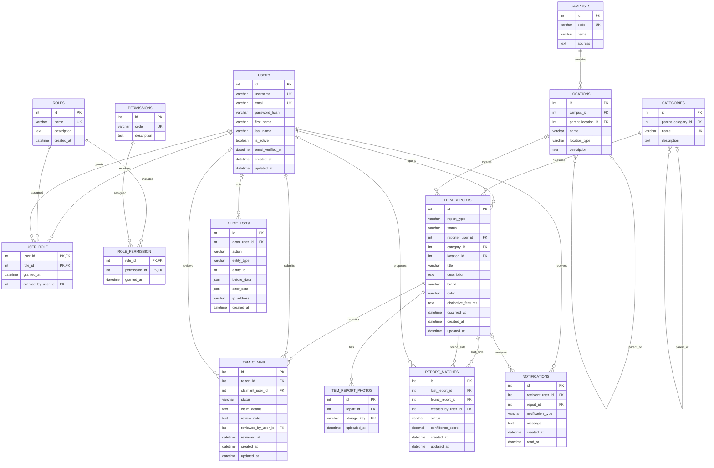

# Smart Campus Lost-and-Found Database Schema

This document describes the MySQL schema for the Smart Campus Lost-and-Found
system. The SQLAlchemy models in `app/model/` are the application mapping;
Alembic migrations are the versioned source of truth for applying changes.
`DATABASE_SCHEMA.sql` is a schema-only MySQL DDL export for review or import
into an ERD tool. The Mermaid ERD is also available in `DATABASE_ERD.mmd`.
The formatted Word version is `DATABASE_SCHEMA.docx`.

## Scope and design

The schema covers campus locations, lost/found reports, report photos, claims,
possible lost/found matches, notifications, role-based access control, and
audit history. A report is a description of a lost or found occurrence. A
single real-world object can therefore have separate lost and found reports;
`report_matches` connects those reports without duplicating or overwriting
their report details.

The model is normalized to third normal form for its reference and
transactional data:

1. **First normal form:** each field stores one value. Photos, role grants,
   permissions, claims, matches, and audit events are separate rows rather
   than lists embedded in a report or user.
2. **Second normal form:** the two many-to-many junctions use composite
   primary keys. Their attributes describe the grant represented by that
   complete key.
3. **Third normal form:** campus, hierarchical location, category, role, and
   permission descriptions are stored once in their own tables and referenced
   by foreign keys. Reports and claims hold their own transaction-specific
   facts, not copies of those reference names.

This design supports more than one campus. `locations` models buildings,
floors, rooms, and other nested places using a self-reference.

## ER diagram



## Tables and constraints

| Table | Purpose and key constraints |
|---|---|
| `users` | User identities and account state. `username` and `email` are unique; `password_hash` is required. The legacy Python attribute `password` aliases `password_hash` for existing model callers; it is not a second database column. |
| `roles` | Named authorization roles; `name` is unique. |
| `permissions` | Individual capabilities identified by unique `code` values. |
| `user_role` | User-to-role grants. Composite primary key prevents duplicate assignments; `granted_by_user_id` and `granted_at` record grant provenance. |
| `role_permission` | Role-to-permission grants. Composite primary key prevents duplicate grants. |
| `campuses` | Campus reference data. `code` is unique. |
| `locations` | Buildings/areas/rooms belonging to a campus. Self-referencing parent supports a location hierarchy; sibling names are constrained by campus, parent, and name. |
| `categories` | Item category reference data. A self-reference supports category trees; category names are unique. |
| `item_reports` | Lost or found report details, reporter, category, optional location, lifecycle status, and occurrence time. `report_type` and `status` use check constraints. |
| `item_report_photos` | One row per photo reference; `storage_key` is unique. Image bytes stay in file/object storage, not in MySQL. |
| `item_claims` | Claims on reports, including claimant, submitted proof/details, review decision, and optional reviewer. One claimant may create at most one claim per report. |
| `report_matches` | Candidate pairing between lost and found reports. A report pair is unique, IDs must differ, and an optional confidence score must be 0–100. |
| `notifications` | Per-recipient messages with optional related report and read time. |
| `audit_logs` | Change/security event history with actor, action, entity reference, optional before/after JSON, IP address, and event time. The entity reference is intentionally polymorphic and is not a foreign key. |

### Relationships

- One campus has many locations; a location may contain child locations.
- A user may have many roles and a role may belong to many users through
  `user_role`. Roles and permissions are similarly connected through
  `role_permission`.
- A user submits reports. Each report belongs to one category and can point to
  one optional location; it may have many photos, claims, and notifications.
- A claim has one claimant and one report; an optional reviewer is another
  user.
- A match links one lost report to one found report. Both references point to
  `item_reports`.
- An audit event may reference an actor, but actor deletion does not erase the
  audit record.

### Important enforcement boundaries

Foreign keys, unique keys, and check constraints enforce row-level integrity.
Business rules that span rows must also be checked by the application in a
transaction: a claim must target a `FOUND` report; a match must pair a `LOST`
report with a `FOUND` report; a location parent must belong to the same campus;
and category/location hierarchies must not contain cycles. MySQL permits
multiple `NULL` values in a unique key, so root-level location names also need
an application-level duplicate check. MySQL `CHECK` constraints cannot query
other rows to enforce these rules.

The database contains the RBAC tables and audit-log storage, not the
authentication, permission-checking, or audit-writing application code. Store
only a secure password hash in `password_hash`; never persist a plain password.
Audit events should be written by application code for privileged and
state-changing operations, and treated as append-only.

## Applying and maintaining the schema

The MySQL connection comes from `DATABASE_URL` in the local environment.
Apply the versioned migration with:

```powershell
.\env\Scripts\python.exe -m alembic upgrade head
```

After changing models, generate and review a migration before applying it:

```powershell
.\env\Scripts\python.exe -m alembic revision --autogenerate -m "Describe schema change"
.\env\Scripts\python.exe -m alembic upgrade head
```

Do not run `Base.metadata.create_all()` against an already-managed database;
Alembic tracks schema history. The `alembic_version` table is migration
metadata and is not part of the application ERD.
